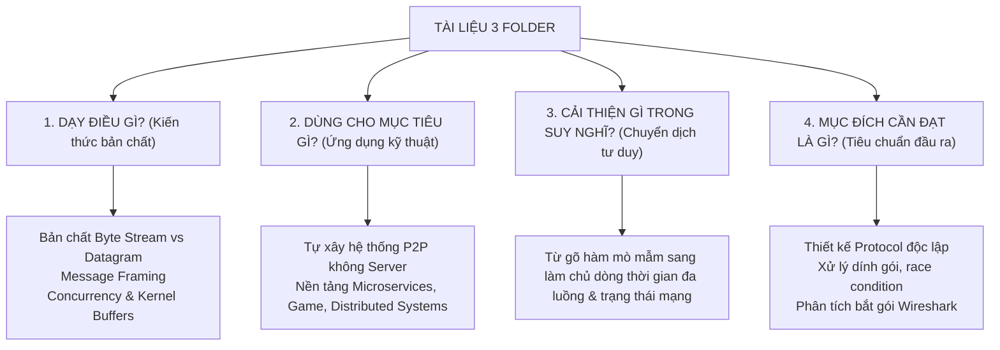

# BẢN ĐỒ BẢN CHẤT MẠNG MÁY TÍNH & LẬP TRÌNH SOCKET
## *Giải mã toàn diện 3 thư mục Project theo phương pháp tư duy Richard Feynman*

> *"Biết tên một loài chim trong tất cả các thứ tiếng trên thế giới không có nghĩa là bạn hiểu bất kỳ điều gì về con chim đó."*  
> — **Richard Feynman**

---

## 0. LỜI MỞ ĐẦU: PHÁ BỎ ẢO TƯỞNG VỀ "SOCKET"

Hầu hết sinh viên tiếp cận môn Mạng Máy Tính đều mắc phải căn bệnh mà Feynman gọi là **Học vẹt hình thức (Cargo-Cult Science)**: Họ thuộc làu tên các hàm `socket()`, `bind()`, `listen()`, `accept()`, `send()`, `recv()`. Họ gõ code chạy được trên máy mình, nhưng khi mạng lag, khi hai người gõ cùng lúc, hoặc khi gửi một bức ảnh dung lượng lớn, hệ thống vỡ vụn và họ hoàn toàn bế tắc.

**Bản chất thực sự là gì?**
1. **Một Socket không phải là một tệp, cũng không phải là sợi dây cáp:** Nó là một **Cánh Cửa (File Descriptor / Handle)** do Hệ điều hành (Kernel) quản lý, nối không gian bộ nhớ của chương trình bạn (User Space) với hai hàng đợi bộ đệm trong nhân hệ điều hành (Kernel Send Buffer & Kernel Receive Buffer).
2. **Internet không có "tin nhắn", chỉ có "dòng byte" hoặc "bưu thiếp bay trong bão":** 
   - **TCP** không gửi tin nhắn, nó là một **ống dẫn nước**. Bạn đổ vào 100 giọt nước, đầu bên kia có thể hứng được từng giọt hoặc ùa ra một xô nước.
   - **UDP** là **những phát bắn súng cao su**. Mỗi phát là một viên sỏi độc lập mang theo mảnh giấy. Nó có thể bay trúng đích, hoặc bị gió thổi bay mất tăm.

Dự án này tập hợp 3 thư mục học liệu để dẫn dắt bạn từ một người "chép code ví dụ" trở thành một **Kỹ sư Hệ thống Phân tán (Distributed Systems Engineer)** thực thụ.

---

## I. GIẢI PHẪU 3 THƯ MỤC TRONG PROJECT: BẢN ĐỒ TIẾN HÓA CỦA HỆ THỐNG

Dự án của bạn không hề được sắp xếp ngẫu nhiên. Nó đại diện cho 3 nấc thang nhận thức:

```
┌─────────────────────────────────────────────────────────────────────────────┐
│ NẤC THANG 1: HỌC MẪU & NỀN TẢNG CƠ BẢN (Folder: Tai_lieu_Socket/)          │
│ - HDLT_Socket.pdf, David Beazley Book, sample_code (01, 02, 03)             │
│ - Tiến hóa: TCP đơn hướng -> Echo tuần tự -> Server đa luồng (Tkinter)      │
└──────────────────────────────────────┬──────────────────────────────────────┘
                                       │ Thấy được giới hạn: Client-Server tập trung!
                                       ▼
┌─────────────────────────────────────────────────────────────────────────────┐
│ NẤC THANG 2: BẢN ĐỒ LÝ THUYẾT & KỊCH BẢN CHUẨN (Folder: Seminar_Project1...) │
│ - Seminar_Socket Programming.pdf & Gioithieu_Huongdan_DoAnSocket.pdf        │
│ - Mô hình hóa: Ranh giới tầng mạng, Kịch bản P2P, Bắt gói Wireshark         │
└──────────────────────────────────────┬──────────────────────────────────────┘
                                       │ Chuyển hóa thành sản phẩm thực chiến!
                                       ▼
┌─────────────────────────────────────────────────────────────────────────────┐
│ NẤC THANG 3: HIỆN THỰC HÓA ĐỒ ÁN THỰC CHIẾN (Folder: UDP_TCP_projects/)    │
│ - LAN_Chat_Socket_Project.docx, udp_broadcast_demo.py, option_a/b redraw.py │
│ - Đỉnh cao: P2P Chat + File song song + Terminal Redraw + Message Framing   │
└─────────────────────────────────────────────────────────────────────────────┘
```

### 1. Thư mục `Tai_lieu_Socket/`: Phòng thí nghiệm vi mô
- **Gồm có:** `HDLT_Socket.pdf`, tài liệu kinh điển của David Beazley (`PythonNetBinder.pdf`), các mã nguồn mẫu từ `01` đến `03`.
- **Vai trò:** Dạy ngữ pháp cơ bản của Socket API. 
  - `01_server.py / 01_client.py`: Giao tiếp 1 chiều tối giản. Client nói, Server nghe rồi in ra.
  - `02_server.py / 02_client.py`: Giao tiếp 2 chiều nhưng **bị khóa cứng (Lockstep)**. Client nói -> Server nghe -> Server gõ trả lời -> Client nghe. Nếu Server chưa gõ xong, Client bị chặn (Block) hoàn toàn.
  - `03_server.py / 03_client.py`: Sự khai sinh của **Đa luồng (Multithreading)**. Tách luồng nhận tin (`recv`) khỏi luồng giao diện GUI, cho phép Server broadcast tin nhắn tới nhiều Client.

### 2. Thư mục `Seminar_Project1_SocketProgramming-20261124/`: Bản đồ chiến lược
- **Gồm có:** `Seminar_Socket Programming.pdf` và `Gioithieu_Huongdan_DoAnSocket.pdf`.
- **Vai trò:** Cung cấp bức tranh toàn cảnh về kiến trúc hệ thống và quy trình thực hiện.
  - Định vị ứng dụng ở **Biên mạng (Network Edge)**: Router chỉ chuyển tiếp gói tin, chỉ có hai máy đầu cuối mới mang logic ứng dụng.
  - Chuyển dịch từ mô hình tập trung (Client-Server truyền thống) sang **Mô hình Ngang hàng Đối xứng (Symmetric P2P)**: Mỗi máy vừa là Server (nghe ngóng kết nối), vừa là Client (chủ động kết nối).
  - Phân tích kịch bản giao tiếp (Choreography) từ bắt tay SYN/ACK, phát hiện láng giềng qua UDP broadcast, cho đến kiểm chứng thực nghiệm bằng Wireshark.

### 3. Thư mục `UDP_TCP_projects/`: Đấu trường thực tế
- **Gồm có:** `LAN_Chat_Socket_Project.docx`, `udp_broadcast_demo.py`, `option_a_prompt_toolkit.py`, `option_b_manual_redraw.py`, `chat_redraw.cpp`.
- **Vai trò:** Đối mặt với những bài toán hóc búa của kỹ thuật phần mềm mạng:
  - **Bài toán xung đột ngõ ra Terminal:** Khi bạn đang gõ dở một câu chat thì tin nhắn đối phương ập đến. Làm sao để tin nhắn chèn lên trên mà câu bạn đang gõ không bị vỡ nát? (Giải pháp: ANSI Escape `\r\033[K` và vẽ lại dòng đệm).
  - **Bài toán chia sẻ Port Broadcast:** Làm sao để 3 chương trình chạy trên cùng 1 máy tính có thể nhận chung gói tin broadcast UDP port 9999? (Giải pháp: `SO_REUSEADDR` / `SO_REUSEPORT`).
  - **Bài toán Message Framing:** Tự tay thiết kế giao thức cấp ứng dụng (Application Layer Protocol) để giải quyết hiện tượng dính gói/vỡ gói của TCP.

---

## II. BỐN CÂU HỎI CỐT LÕI VỀ BẢN CHẤT CỦA TOÀN BỘ PROJECT



---

### CÂU HỎI 1: CÁC NỘI DUNG ĐÓ MUỐN DẠY TÔI ĐIỀU GÌ?
*(Bóc tách bản chất - Không dùng thuật ngữ sáo rỗng)*

#### 1. Sự phân công vật lý giữa TCP và UDP (Dòng nước vs Bưu thiếp)
- **Thí nghiệm chiếc vòi nước (TCP):** Khi bạn mở van xả 100 lít nước, nước chảy qua đường ống thành một dòng liên tục. Bên đầu nhận có một cái chậu (Kernel Buffer). Người nhận múc một bát nước (`recv(1024)`), họ không thể biết bát nước đó thuộc về lần mở van thứ nhất hay lần mở van thứ hai. **TCP không hề có khái niệm "ranh giới tin nhắn" (Message Boundary).**
- **Thí nghiệm bưu thiếp phát thanh (UDP Broadcast):** Bạn đứng trên sân khấu cầm loa hét lớn: `HELLO|Quan|5000|online`. Bất kỳ ai trong hội trường (cùng mạng LAN) đều nghe thấy một lần trọn vẹn. Nếu ai đó ngủ gật hoặc có tiếng ồn át đi (mất gói), bạn không quan tâm, vì 3 giây sau bạn lại cầm loa hét lại câu đó.

#### 2. Kỹ năng thiết kế Giao thức Ứng dụng & Đóng gói (Message Framing)
- Sinh viên ngây thơ thường nghĩ: `client.sendall(b"Hello")` thì bên kia `recv()` sẽ nhận đúng chữ `"Hello"`.
- **Thực tế tàn khốc:** Nếu bạn gửi liên tiếp 2 tin `"Hello"` và `"World"`, bên nhận có thể nhận về `"HelloWor"` ở lần đọc 1, và `"ld"` ở lần đọc 2 (hiện tượng dính gói và vỡ gói).
- **Bài học:** Bạn phải tự phát minh ra ngôn ngữ trao đổi (Protocol):
  - Định dạng có Header độ dài: `MSG|<length>|<payload>` (ví dụ: `MSG|5|Hello`). Bên nhận đọc Header trước, trích xuất con số `5`, sau đó chạy vòng lặp đọc cho đến khi gom đủ đúng `5` bytes thì mới đóng gói thành 1 tin nhắn hoàn chỉnh.

#### 3. Bản chất của I/O Blocking và Nghệ thuật Đồng thời (Concurrency)
- Hàm `recv()`, `accept()`, và `input()` đều là các hàm **chặn (Blocking call)**. Chúng khiến luồng thực thi dừng lại, nhường CPU cho tiến trình khác và ngủ đông cho đến khi có dữ liệu từ card mạng hoặc bàn phím.
- Nếu chỉ có 1 luồng duy nhất, chương trình của bạn sẽ bị "liệt": Khi đang đợi người dùng gõ phím, nó không thể nhận tin nhắn bạn bè gửi tới; khi đang đợi nhận file, nó không thể gửi tin báo online.
- **Bài học:** Phải phân rã thành các luồng chuyên biệt, mỗi luồng chỉ chờ đợi đúng một việc duy nhất:
  - Luồng 1 (Main): Chờ phím từ người dùng.
  - Luồng 2 (UDP Broadcaster): Hẹn giờ ngủ 3s rồi bắn gói tin báo danh.
  - Luồng 3 (UDP Listener): Luôn túc trực nghe cổng 9999 để phát hiện bạn bè online/offline.
  - Luồng 4 (TCP Acceptor): Túc trực chờ kết nối mới từ đối tác muốn chat.
  - Luồng $5 \dots N$ (TCP Receivers & File Workers): Túc trực nhận dữ liệu từ từng cuộc hội thoại.

---

### CÂU HỎI 2: DÙNG CHO MỤC TIÊU GÌ?
*(Ý nghĩa thực tiễn & Năng lực kỹ thuật)*

#### 1. Mục tiêu cục bộ: Chế tạo phần mềm P2P LAN Chat & File Transfer hoàn chỉnh
- Ứng dụng chạy trên Terminal nhưng có đầy đủ các tính năng hiện đại:
  - Tự động nhận diện thiết bị trong mạng mà **không cần máy chủ trung tâm (Serverless P2P)**.
  - Chat thời gian thực không gián đoạn giao diện gõ.
  - Truyền tệp nhị phân tốc độ cao với thanh tiến độ phần trăm, không làm đứng luồng chat.
  - Bền bỉ trước các lỗi: đối phương tắt máy đột ngột, rút dây mạng, gửi file rỗng.

#### 2. Mục tiêu kỹ thuật dài hạn: Nền tảng của Kiến trúc Hệ thống Hiện đại
- **Bạn đang học cách các "ông lớn" vận hành:**
  - **BitTorrent / IPFS:** Bản chất cơ chế tìm kiếm node trong mạng cục bộ của đồ án chính là tiền thân của cơ chế Peer Discovery trong mạng Torrent.
  - **gRPC / HTTP 2 / WebSocket:** Cơ chế framing `MSG|<len>|<data>` chính là dạng thức nguyên thủy của các khung nhị phân (Binary Framing) trong giao thức HTTP/2 và WebSocket.
  - **Game Online đa người chơi:** Tọa độ nhân vật di chuyển liên tục được bắn qua UDP (mất 1 tọa độ không sao, tọa độ kế tiếp sẽ bù đắp); giao dịch mua đồ trong game được chuyển qua TCP (tuyệt đối không được rơi rớt 1 byte nào).

---

### CÂU HỎI 3: CẢI THIỆN GÌ TRONG SUY NGHĨ CỦA BẠN?
*(Chuyển hóa tư duy - Từ người học vẹt sang Kỹ sư bản chất)*

| Đặc điểm              | Tư duy học vẹt (Cargo-Cult)                                          | Tư duy kỹ sư bản chất (Feynman Mindset)                                                                                                                   |
| :-------------------- | :------------------------------------------------------------------- | :-------------------------------------------------------------------------------------------------------------------------------------------------------- |
| **Bản chất Socket**   | Nghĩ socket là sợi dây nối ảo hoặc biến số trong code.               | Hiểu socket là **con trỏ điều khiển buffer trong Kernel**. Dữ liệu nằm ở RAM của OS trước khi vào app.                                                    |
| **Gửi/Nhận dữ liệu**  | Tin rằng gọi `send("A")` thì đối phương lập tức `recv()` được `"A"`. | Biết rằng `send()` chỉ đẩy bytes vào Send Buffer. Gói tin có thể bị phân mảnh, dính chùm, trễ hàng đợi.                                                   |
| **Lỗi mạng**          | Cho rằng mạng máy tính luôn ổn định; gặp lỗi thì crash chương trình. | Xem mạng là **kênh truyền nguy hiểm và không đáng tin cậy**. Luôn đón đầu trường hợp đứt cáp, timeout, crash bằng `try...catch`, cờ heartbeat và timeout. |
| **Luồng (Threading)** | Tạo luồng vô tội vạ, không dùng Lock; màn hình in đè loạn xạ.        | Hiểu rõ tài nguyên dùng chung (Shared State): bảo vệ biến danh sách peer và màn hình console bằng **Mutex Lock**.                                         |
| **Giao thức**         | Phụ thuộc vào thư viện bên thứ 3 đóng gói sẵn.                       | **Tự thiết kế giao thức nhị phân/văn bản**, kiểm soát từng byte truyền đi trên đường truyền.                                                              |

**Bước nhảy nhận thức vĩ đại nhất:** Bạn sẽ ngừng nhìn nhận phần mềm như một chuỗi câu lệnh chạy từ trên xuống dưới (tuần tự), mà nhìn nhận nó như một **vũ điệu đa chiều của các tiến trình độc lập**, giao tiếp với nhau bằng các luồng xung điện và ánh sáng qua các cổng logic.

---

### CÂU HỎI 4: MỤC ĐÍCH CẦN ĐẠT SAU NHỮNG BÀI GIẢNG ĐÓ LÀ GÌ?
*(Checklist năng lực thực chiến & Chuẩn đầu ra)*

Sau khi hoàn thành và thấu suốt 3 thư mục tài liệu này, bạn phải đạt được 5 chuẩn năng lực không thể chối cãi:

1. **Năng lực Lập trình Tầng mạng Cấp thấp (Low-Level Socket Mastery):**
   - Tự tay khởi tạo, cấu hình Socket Options (`SO_REUSEADDR`, `SO_REUSEPORT`, `SO_BROADCAST`), hiểu rõ tác động của chúng đối với bảng định tuyến cổng của hệ điều hành.
2. **Năng lực Thiết kế Giao thức (Protocol Engineering):**
   - Viết được bộ phân tích cú pháp (Parser) xử lý dòng byte liên tục (Stream), hiện thực hóa vòng lặp `recv()` gom đủ số byte quy định trong Header trước khi bàn giao cho tầng ứng dụng.
3. **Năng lực Lập trình Đồng thời & An toàn Đa luồng (Thread-Safety):**
   - Quản lý đồng thời 5-6 luồng trong một tiến trình mà không xảy ra hiện tượng thắt cổ chai (Deadlock), xung đột dữ liệu (Race Condition) hay tranh chấp in ấn ra terminal.
4. **Năng lực Thao tác Giao diện Console Nâng cao (Terminal Control):**
   - Nắm vững cách thức hoạt động của con trỏ màn hình, mã điều khiển ANSI escape sequence, điều phối việc vẽ lại giao diện thời gian thực (Asynchronous CLI Redraw).
5. **Năng lực Quan sát & Đo kiểm Thực nghiệm (Network Observability):**
   - Sử dụng thành thạo **Wireshark** và **Netcat**: Nhìn thấy tận mắt cờ SYN, ACK, FIN trong quá trình bắt tay 3 bước; đo được kích thước payload UDP broadcast; giải thích được tại sao gói tin lại đến hoặc không đến đích.

---

## III. THÍ NGHIỆM TƯ DUY FEYNMAN CHO DỰ ÁN CỦA BẠN

### 1. Thí nghiệm "Bức thư tình và Các phong bì lồng nhau" (Encapsulation)
- Khi bạn gõ: `"Minh ơi, slide xong chưa?"`:
  - **Tầng ứng dụng:** Dán thêm nhãn giao thức: `MSG|26|Minh ơi, slide xong chưa?`. Bỏ vào phong bì thứ nhất.
  - **Tầng giao vận (TCP):** Dán thêm nhãn cổng: `Source Port: 5000, Dest Port: 6000`, kèm số thứ tự `Seq=101`. Bỏ vào phong bì thứ hai.
  - **Tầng mạng (IP):** Dán thêm địa chỉ nhà: `Source IP: 192.168.1.10, Dest IP: 192.168.1.12`. Bỏ vào phong bì thứ ba.
  - **Tầng liên kết (Ethernet):** Dán nhãn xe tải: `MAC đích của Switch / Card mạng`.
- **Nguyên tắc Feynman:** Switch hay Router chỉ được phép nhìn vỏ phong bì ngoài cùng để chở đi. Bác tài xế xe tải (Switch) tuyệt đối không được bóc phong bì trong để đọc trộm thư tình!

### 2. Thí nghiệm "Bảng điểm danh ở hội trường" (UDP Heartbeat & Lease Time)
- Tại sao phải broadcast `HELLO` mỗi 3 giây và timeout sau 10 giây?
- Hãy tưởng tượng một hội trường 100 người. Cứ 3 giây, mỗi người phải giơ tay hô to: *"Tôi còn thức!"*.
- Người quản lý cầm bút chì đánh dấu vào sổ. Nếu một người im lặng trong 10 giây (quá 3 chu kỳ hô), người quản lý suy luận: *"Anh này chắc chắn đã ngất xỉu hoặc rời hội trường"*, và dùng gôm tẩy tên người đó khỏi bảng online.
- Không cần thủ tục đăng xuất rườm rà, hệ thống tự động đạt tới trạng thái cân bằng động!

---

## IV. BỘ CÂU HỎI CHẨN ĐOÁN NGỘ NHẬN (DIAGNOSTIC MISCONCEPTION PROBES)
*(Kiểm tra xem bạn thực sự hiểu bản chất hay chỉ học vẹt)*

#### Câu hỏi 1: Về bản chất của TCP `sendall()`
> **Tình huống:** Trong file `01_client.py`, bạn gọi `client.sendall(b"Hello")`. Hàm này trả về thành công mà không ném ra lỗi nào.
> **Câu hỏi:** Điều đó có chứng minh rằng máy chủ bên kia đã nhận được chữ `"Hello"` chưa? Tại sao?
<details>
<summary><b>Lời giải bản chất Feynman (Nhấp để mở)</b></summary>

**CHƯA HỀ!**  
Hàm `sendall()` trả về thành công chỉ có nghĩa là: Toàn bộ các bytes `"Hello"` đã được sao chép thành công từ bộ nhớ của chương trình bạn (User Space) vào **Kernel Send Buffer** của máy bạn. Lúc này, card mạng thậm chí có thể còn chưa kịp phát xung điện nào ra dây cáp! Nếu ngay sau đó bạn giật phích cắm mạng, `sendall` đã xong nhưng bên kia vĩnh viễn không nhận được một byte nào.
</details>

#### Câu hỏi 2: Về hiện tượng dính gói TCP
> **Tình huống:** Bên gửi gọi `sendall(b"MSG|2|Hi")`, ngay sau đó gọi `sendall(b"MSG|3|Bye")`. Bên nhận gọi `data = conn.recv(1024)`.
> **Câu hỏi:** Bên nhận có chắc chắn nhận được chuỗi `"MSG|2|Hi"` ở lần `recv()` đầu tiên không?
<details>
<summary><b>Lời giải bản chất Feynman (Nhấp để mở)</b></summary>

**HOÀN TOÀN KHÔNG CHẮC CHẮN!**  
Hệ điều hành có thuật toán Nagle (gom nhiều gói nhỏ thành gói to để tiết kiệm băng thông). Hệ điều hành có thể gộp cả hai mẩu tin lại và `recv(1024)` sẽ trả về chuỗi dính liền: `"MSG|2|HiMSG|3|Bye"`. Nếu bên nhận không viết bộ tách khung (Framing Parser) dựa vào độ dài `|2|` và `|3|`, chương trình sẽ bị lỗi định dạng ngay lập tức.
</details>

#### Câu hỏi 3: Về việc tách riêng kết nối truyền File và Chat
> **Tình huống:** Đề bài yêu cầu: Khi đang chat với Minh, nếu gửi file `slides.pdf` (100MB), chương trình mở một kết nối TCP thứ hai song song thay vì gửi chung trên kết nối chat hiện tại.
> **Câu hỏi:** Tại sao không gửi nối tiếp file trên cùng kết nối chat? Chuyện gì sẽ xảy ra với trải nghiệm người dùng nếu gửi chung?
<details>
<summary><b>Lời giải bản chất Feynman (Nhấp để mở)</b></summary>

**BẢN CHẤT HÀNG ĐỢI FIFO CỦA TCP!**  
Nếu bạn đổ 100MB file vào cùng 1 đường ống TCP, toàn bộ các byte đó sẽ xếp hàng chiếm trọn đường truyền. Trong lúc đó, nếu bạn gõ một tin nhắn khẩn cấp: *"Đừng nhận file, nhầm rồi!"*, tin nhắn đó buộc phải xếp hàng sau 100 triệu bytes của file! Người nhận sẽ chỉ đọc được tin nhắn sau khi đã tải xong toàn bộ 100MB. Bằng cách tách ra một socket TCP độc lập cho file, hệ điều hành sẽ chia sẻ băng thông (Multiplexing) ở tầng mạng, giúp tin nhắn chat vài bytes vẫn bay tới đích tức thì.
</details>

#### Câu hỏi 4: Về cổng UDP Broadcast 9999
> **Tình huống:** Bạn chạy 2 cửa sổ terminal trên cùng một laptop để test tính năng khám phá peer. Cả hai cửa sổ đều gọi `s.bind(('', 9999))`.
> **Câu hỏi:** Mặc định hệ điều hành có cho phép hai tiến trình cùng bind vào một cổng không? Cần cờ ma thuật nào để làm được điều đó và nguyên lý hoạt động của nó là gì?
<details>
<summary><b>Lời giải bản chất Feynman (Nhấp để mở)</b></summary>

**MẶC ĐỊNH SẼ BỊ LỖI `Address already in use`!**  
Hệ điều hành cần biết gói tin đến cổng 9999 phải chuyển cho tiến trình nào. Để nhiều tiến trình cùng nghe chung một cổng UDP broadcast, bạn bắt buộc phải bật cờ:
`s.setsockopt(socket.SOL_SOCKET, socket.SO_REUSEADDR, 1)` (và trên Linux/macOS là `SO_REUSEPORT`).  
Cờ này ra lệnh cho Kernel: *"Hãy nhân bản gói tin UDP đến cổng này và phân phối bản sao cho tất cả các socket đã đăng ký nghe chung cổng đó!"*
</details>

---

## V. TỔNG KẾT: HÀNH TRÌNH TỪ BÂY GIỜ ĐẾN BẢN DEMO HOÀN HẢO

Để hoàn thành xuất sắc đồ án này, bạn hãy tuân thủ lộ trình 6 bước được đúc rút từ tài liệu hướng dẫn:

```
[BƯỚC 0: ĐẶC TẢ GIAO THỨC]
Thiết kế định dạng gói UDP (HELLO, AWAY) và TCP (MSG, FILE, BYE). Viết ra giấy trước khi code!
       │
       ▼
[BƯỚC 1: LÀM CHỦ SOCKET NỀN TẢNG]
Chạy thử echo client/server trong Tai_lieu_Socket/sample_code/. Dùng Netcat (nc) để bắn thử byte.
       │
       ▼
[BƯỚC 2: KHÁM PHÁ PEER QUA UDP BROADCAST]
Ghép mã nguồn từ udp_broadcast_demo.py. Hiện thực hóa danh sách online và bộ đếm ngược 10s.
       │
       ▼
[BƯỚC 3: XÂY DỰNG KHUNG GIAO TIẾP TCP 1-1]
Thiết lập TCP Acceptor và Receiver. Bắt tay HI|<name>| và truyền tin nhắn có header độ dài.
       │
       ▼
[BƯỚC 4: GIẢI CỨU GIAO DIỆN BẰNG TERMINAL REDRAW]
Áp dụng option_a_prompt_toolkit.py hoặc option_b_manual_redraw.py để chat không bị đè chữ.
       │
       ▼
[BƯỚC 5: TRUYỀN FILE SONG SONG & BẮT GÓI WIRESHARK]
Mở luồng riêng truyền file nhị phân. Mở Wireshark chụp lại 3-way handshake và broadcast để làm báo cáo!
```

Khi bạn hoàn thành đồ án này bằng tư duy bản chất, bạn không chỉ qua môn Mạng Máy Tính với điểm số tuyệt đối, mà bạn đã chính thức bước qua ngưỡng cửa của một **Kỹ sư Phần mềm Hệ thống** có khả năng nhìn thấu từng byte dữ liệu đang chuyển động trên mạng Internet toàn cầu.
